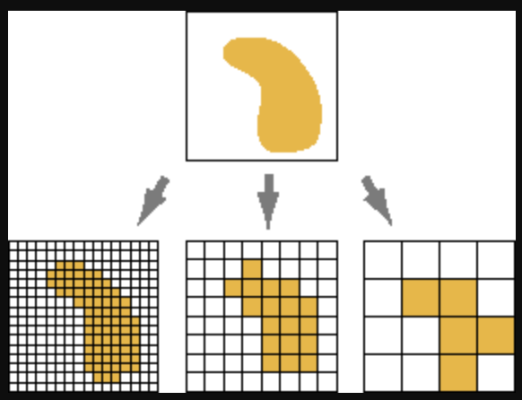

Definitions
================

There are several key terms to cover before we begin working with
spatial data.

## GIS

A geographic information system (GIS) is a computer-based
tool/technology that is used to manage, create, combine, analyze, and
visualize spatial data. For example, many GIS professionals use the
proprietary tool [ArcGIS
Pro](https://www.esri.com/en-us/arcgis/products/arcgis-pro/overview) for
mapping and analysis tasks. Esri, the company that owns ArcGIS Pro,
defines GIS as follows:

> GIS connects data to a map, integrating location data (where things
> are) with all types of descriptive information (what things are like
> there). This provides a foundation for mapping and analysis that is
> used in science and almost every industry. GIS helps users understand
> patterns, relationships, and geographic context. The benefits include
> improved communication, efficiency, management, and decision-making.
> [(Link)](https://www.esri.com/en-us/what-is-gis/overview)

[QGIS](https://qgis.org/) is free and open source, and it is a great
alternative to ArcGIS Pro that can complete many of the same
visualization and analysis tasks.

## Spatial Data

Spatial data is what the Esri definition above refers to as “location
data (where things are).” Spatial datasets, or features, contain
*geometry* that tells the GIS or other tool where and how to draw the
features on a map. There are many file types for spatial data; some of
the more common ones include shapefiles, GeoJSON, and KML files.

A spatial dataset may contain **vector** or **raster** data, and it’s
important that we understand the differences between the two.

### Vector Data

Vector data, or vector features, are comprised of vertices and paths. In
other words, vector features have *geometry*. Depending on what is being
mapped, that geometry might be **points**, **lines**, or **polygons**:

| Feature | Definition | Example |
|:---|:---|:---|
| Points | Single-point locations | locations of schools |
| Lines | Geographic objects too narrow to depict as areas, or features that have length but no area | public transportation routes, contour lines |
| Polygons | Many-sided area features representing the shape and location of homogenous feature types | counties, land-use zones |

### Raster Data

While vector features are made up of points and lines, raster data is
comprised of pixels, or grid cells. These cells are arranged in rows and
columns (the grid), and each cell contains a single value representing
information at that location (for example, rainfall in inches). A
typical example of raster data is satellite imagery.

Rasters are especially useful for representing data that varies
**continuously**, like elevation or temperature. They can also show
**discrete** data, like soil types or land use (for example, green cells
to show forests and brown to show agriculture).

The **spatial resolution** of raster data determines the level of detail
shown on the resulting map. We can also think of spatial resolution as
the pixel/cell size of the raster: every pixel in a raster represents an
area of the same width and height (and every other pixel in that raster
will represent an area of the same dimensions).

If the area represented by a single pixel is 50 square feet, the map
will be less granular than if a single pixel represents 5 square feet.
In other words, the higher the pixel size, the lower the resolution.

<figure>

<figcaption aria-hidden="true">Example of spatial resolution from
Esri.</figcaption>
</figure>

## Attribute Data

Returning to Esri’s definition of GIS, attribute data is the
“descriptive information (what things are like there),” where *there*
refers to the locations specified by the spatial data. Attribute data
looks more like what we might imagine when we think of data:
spreadsheets with columns, or variables, and rows with cells, or values.
These are the attributes of, or information about, the spatial data,
whether vector (the population density of the county, the color of the
train line, the average standardized test score of the school) or raster
(the elevation, vegetation type, temperature, or population density).

Taken together, spatial and attribute data can form a map, where the
spatial data features designate what kinds of features go *where*, and
the attribute datasets specify *how* the features appear.

## Coordinate Reference System (CRS)

The simplest definition of a CRS is the designation of how features on a
two-dimensional map are related to real locations on Earth (accomplished
through coordinates).

> IMPORTANT: When combining more than one spatial data layer, it’s
> crucial that all layers are in the same CRS, so that the geographic
> features are accurately positioned relative to each other.

If you care for more details, it’s useful to zoom out and remember that
we create a map, our task is to visualize a three-dimensional object
(the surface of the earth) onto a two-dimensional plane (a computer
screen or piece of paper). Therefore, geographic features are shown in
**map projections**, techniques developed by cartographers to as
accurately as possible represent the globe in 2D space. Every projection
distorts the world in one or more of the characteristics of **angular
conformity**, **distance**, and **area**. The right map projection for a
given GIS project depends on the *scale* of that project (for example,
are we mapping the whole world, or Notre Dame’s campus?) and the goals
of the project (for example, if you intend to analyze distances, a map
projection with less distance distortion is preferable).

Once the map projection is chosen, the CRS defines how a given feature
is located on the projection according to three coordinates (x, y, and
*z*, the vertical axis). [This
article](https://earthdatascience.org/courses/earth-analytics/spatial-data-r/intro-to-coordinate-reference-systems/)
from Earth Lab and [this
one](https://docs.qgis.org/3.44/en/docs/gentle_gis_introduction/coordinate_reference_systems.html)
from QGIS’s documentation may be helpful if you’d like to read up more.
There may be projects in the future where you will need to decide on a
CRS; for today, we are simply interested in how we find out what CRS a
spatial feature is already in, and how we make sure multiple spatial
features have the same CRS.

## Clipping

Clipping, or a *clip analysis*, involves using the geometry (or
geometries) of one spatial layer to “clip out” the geometries from
another layer(s). Typically this is done to reduce a project to a given
study area (e.g., as we will see in our workshop, reducing a spatial
dataset of New York City to just Manhattan). The best way to picture
clipping is to imagine that the clipping feature is a cookie cutter;
this feature should always be a polygon feature, so that the borders of
the polygon(s) are the edges of the cookie cutter and the areas within
the borders are the empty space through which we will clip the input
layer(s).

<figure>

<figcaption aria-hidden="true">Example of clipping from Esri, showing
input layer, clip feature, and output.</figcaption>
</figure>

------------------------------------------------------------------------

We are now ready to jump into QGIS.

### Data

During our exploration of QGIS, we will use several datasets from the
[NYC Open Data portal](https://www.nyc.gov/opendata):

- [2015 Street Tree Census - Tree
  Data](https://data.cityofnewyork.us/Environment/2015-Street-Tree-Census-Tree-Data/uvpi-gqnh/about_data)
- [2018 Squirrel Census Fur Color
  Map](https://data.cityofnewyork.us/Environment/2018-Squirrel-Census-Fur-Color-Map/fak5-wcft)
- [New York City Bike
  Routes](https://data.cityofnewyork.us/dataset/New-York-City-Bike-Routes/mzxg-pwib/about_data)
- [Borough
  Boundaries](https://data.cityofnewyork.us/City-Government/Borough-Boundaries/gthc-hcne/about_data)
- [NYC Parks Active and Passive
  Recreation](https://data.cityofnewyork.us/Recreation/NYC-Parks-Active-and-Passive-Recreation/kcqe-vnci/about_data)
